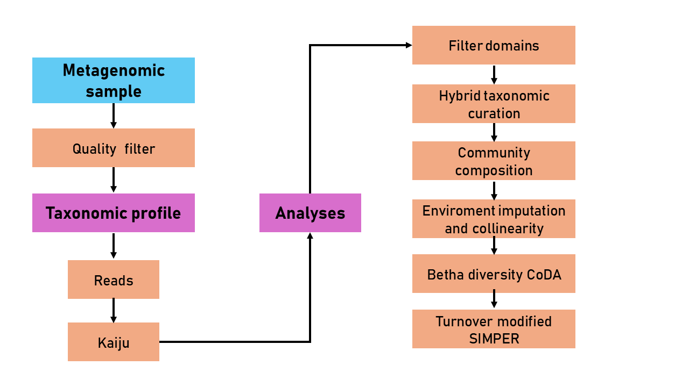

# Characterization of the micro-eukaryote community in the OMZ-ETNP

Oxygen Minimum Zones (OMZs), such as the one in the Eastern Tropical North Pacific (ETNP)—the largest globally—are expanding due to climate change, critically influencing global biogeochemical cycles. However, microbial ecology studies in these systems have focused almost exclusively on prokaryotes, leaving the *in situ* diversity, composition, and ecophysiology of microeukaryotes largely unexplored. Although marine snow (the particle-associated fraction) is known to act as a crucial biogeochemical oasis for marine microorganisms, how microeukaryotes partition between these microniches and free-living lifestyles across vertical oxygen gradients remains a major gap in molecular oceanography. To address this without the massive loss of rare biosphere data from *de novo* assembly or the amplification biases of classic metabarcoding, we implemented a direct, read-based metagenomic profiling pipeline in protein space using Kaiju.

In this repository, you will find the bioinformatic and statistical workflow for the read-based metagenomic analysis of microeukaryotic communities from the ETNPOMZ, evaluating their taxonomic diversity, vertical transitions, and niche preferences (particle-associated vs. free-living fractions) in response to oceanographic variables.

## Aims

1. To recover microeukaryotic sequences from public shotgun metagenomes of the Eastern Tropical North Pacific Oxygen Minimum Zone (ETNP-OMZ).
2. To determine the most representative microeukaryotic taxa across vertical (depth) and horizontal (coastal-to-offshore) gradients, and between free-living and particle-associated microniches.
3. To evaluate the relationship between oceanographic parameters and the diversity and dissimilarity of microeukaryotic communities across the studied microniches.

## Prerequisites

### Operative system
* **Linux Server Environment:** Ubuntu 22.04.5 LTS (64-bit, Bash shell) for high-performance read preprocessing and taxonomic classification.
* **Local / Workstation Environment:** RStudio Desktop for taxonomic curation, statistical modeling, and visualization.

### Software
| Software | Version | Purpose | 
| :--- | :--- | :--- | :--- |
| **FastQC** | `v0.12.1` | Per-base quality assessment and adapter screening of raw and trimmed FASTQ reads | 
| **MultiQC** | `v1.17` | Aggregation of FastQC and Trimmomatic logs into unified HTML summary reports |
| **Trimmomatic** | `v0.39` | Adapter removal (`TruSeq3-PE.fa`) and conservative sliding-window quality filtering | 
| **Kaiju** | `v1.10.1` | Six-frame translation and protein-level taxonomic profiling against `nr_euk` (May 2023) |


### R version
**R Version:** `4.3.0`

**Required R Libraries:**
 * **Taxonomic Curation & Data Wrangling:** `taxize` (`v0.10.1`), `dplyr`, `tidyr`, `stringr`, `reshape2`, `readxl`, `tidyverse`, `rlang`
  * **Alpha Diversity & Coverage Rarefaction:** `iNEXT` (`v3.0.2`)
  * **Compositional Data Analysis & Multivariate Ecology:** `vegan` (`v2.7-3`), `zCompositions` (`v1.6.1`), `compositions`, `gradientForest`
  * **Environmental Imputation & Statistical Testing:** `missForest` (`v1.6.1`), `Hmisc`, `rstatix`, `car`, `corrplot`
  * **Academic Visualization:** `ggplot2`, `ggrepel`, `scales`, `RColorBrewer`, `viridis`, `patchwork`, `extrafont`

## Data
All raw genomic sequences and oceanographic metadata analyzed in this workflow were retrieved from open-access repositories associated with the **Oxygen Minimum Zone Microbial Biogeochemistry Expedition (OMZoMBiE)** aboard the R/V *New Horizon* (Cruise NH1315, June 13–28, 2013) and complementary cruise NH1410 (May–June 2014) off the coast of Jalisco and Colima, Mexico.

### 1. Shotgun metagenomic datasets (NCBI_SRA)
* **NCBI BioProject [PRJNA632347](https://www.ncbi.nlm.nih.gov/bioproject/PRJNA632347):** Offshore Station 2 ($18.92^\circ\text{N}, 108.8^\circ\text{W}$).
  * Origin References: Ganesh et al. (2015) [https://doi.org/10.1038/ismej.2015.44](https://doi.org/10.1038/ismej.2015.44); Muratore et al. (2023) [https://doi.org/10.1128/msystems.01095-22](https://doi.org/10.1128/msystems.01095-22)[cite: 1].
* **NCBI BioProject [PRJNA254808](https://www.ncbi.nlm.nih.gov/bioproject/PRJNA254808):** Coastal Stations 6 ($18.9^\circ\text{N}, 104.5^\circ\text{W}$) and 10 ($18.8^\circ\text{N}, 104.7^\circ\text{W}$).
  * Origin Reference: Glass et al. (2015) [https://doi.org/10.3389/fmicb.2015.00998]


For more information about the samples see the file: [data_sample](Data_metagen.csv)

Where the columns:
* **Bioproyect**: name of the project where the samples were stored.
* **ID access**: number with which the samples are identified.
* **Station**: number of the station where they were collected.
* **Depth**: depth at which the samples were collected.
* **Filter**: size of the filters on which the samples were collected.
* **Type_micro-niche**: micro-niche designated for the samples.
* **Platform**: instrument used in sequencing.
* **Read_Configuration**: Sequencing reading mode and length of the fragments read (in base pairs).
* **N**:Latitude coordinate (North).
* **W**:Longitude coordinate (West).

### 2. Oceanographic & biogeochemical metadata

* **CTD Hydrographic Profiles (Temperature, Salinity, Dissolved $\text{O}_2$, Fluorescence — Cruise NH1315):**
  * Origin Reference: Brum, J. (2020). *5m intervals of CTD profiles from R/V New Horizon cruise NH1315 in the Eastern Tropical North Pacific (ETNP) during June 2013* (Version 1) [Dataset]. BCO-DMO. [https://doi.org/10.26008/1912/BCO-DMO.822818.1](https://doi.org/10.26008/1912/BCO-DMO.822818.1).
* **Dissolved Trace Metals ($\text{dFeT}$ and $\text{dCuT}$ — Cruise NH1315):**
  * Origin Reference: Glass et al. (2015). *Meta-omic signatures of microbial metal and nitrogen cycling in marine oxygen minimum zones*. Frontiers in Microbiology, 6, 998. [https://doi.org/10.3389/fmicb.2015.00998](https://doi.org/10.3389/fmicb.2015.00998).
* **Nitrogen Geochemistry ($\text{NO}_3^-$, $\text{NO}_2^-$) & Complementary Hydrography (Cruise NH1410):**
  * Origin Reference: Altabet, M. A., & McNeil, C. L. (2022). *Vertical profiles of N2 gas concentrations in excess of equilibrium values along with the isotopic composition of total N2, NO3- and NO2- from R/V New Horizon cruise NH1410 in the Eastern Tropical North Pacific from May to June 2014* (Version 1) [Dataset]. BCO-DMO. [https://doi.org/10.26008/1912/BCO-DMO.705567.1](https://doi.org/10.26008/1912/BCO-DMO.705567.1).

For more information about the samples see the file: [amb_data](amb_data.csv)

## Workflow
We used metagenomic shotgun approach as follow:




## Repository structure
This repository has the following structure:
```
.
├── LICENSE
├── README.md
├── data
│   ├── Data_metagen.csv
│   ├── amb_data.csv
│   
├── metagenomics
│   └── bin
│       ├── 01_quality_trimming.sh
│       ├── 02_run_kaiju_reads.sh
│       └── 03_kaiju2table_fullpath.sh
└── analyses
    └── bin
        ├── 1_FilterDomains_Kaiju.R
        ├── 2_HybridTaxonomicCuration.R
        ├── 3_CommunityComposition_Plots.R
        ├── 4_AlphaDiversity_iNEXT_Hotspots.R
        ├── 5_EnvironmentalImputation_Collinearity.R
        ├── 6_BetaDiversity_CoDA_NMDS_dbRDA.R
        ├── 7_Turnover_ModifiedSIMPER.R
    
```

### `/data`
Folder containing sample metadata and physicochemical environmental tables.

* **metadata_samples_ETNP.csv**: Metadata for the 13 shotgun metagenomic samples (BioProject, SRA Accession, Station, Depth, Filter fraction, Microniche, Sequencing platform, and Coordinates).
* **Matriz_Ambiental_COMPLETA_con_NA.csv**: Raw compiled hydrographic ($\text{T}$, $\text{S}$, $\text{O}_2$, Fluorescence), nutrient ($\text{NO}_3^-$, $\text{NO}_2^-$), and trace metal ($\text{dFeT}$, $\text{dCuT}$) matrix prior to imputation.

### `/metagenomics/bin`
Folder with Bash scripts for raw read quality control, adapter trimming, and protein-level taxonomic profiling with `Kaiju`.

* **01_quality_trimming.sh**: Unified iterative script that runs pre-trimming `FastQC` and `MultiQC`, performs paired-end adapter and quality trimming with `Trimmomatic` (`ILLUMINACLIP:2:30:7 LEADING:2 TRAILING:2 SLIDINGWINDOW:4:2 MINLEN:50`), and executes post-trimming `FastQC` and `MultiQC` across all 13 samples.
* **02_run_kaiju_reads.sh**: Script to classify paired-end trimmed reads directly in protein space using `Kaiju` in greedy mode (`-s 70 -E 0.01 -v`) against the `nr_euk` index.
* **03_kaiju2table_fullpath.sh**: Script to convert raw `.kaiju.out` outputs into full taxonomic hierarchy tables (`*_fullpath.tsv`) using `kaiju2table`.

### `/analyses/bin`
Folder with downstream R scripts for taxonomic validation, compositional statistics, diversity estimation, and ecological modeling.

* **1_FilterDomains_Kaiju.R**: Script to parse `*_fullpath.tsv` outputs from `Kaiju`, extract cellular domains, and split records into separate files for *Bacteria*, *Archaea*, *Eukaryota*, *Viruses*, *Unclassified*, and *Cannot be assigned*, generating global domain summary tables.
* **2_HybridTaxonomicCuration.R**: Implements the 3-step hybrid taxonomic engine (`WoRMS Exact` $\rightarrow$ `WoRMS Fuzzy Marine` $\rightarrow$ `NCBI Rescue`) via `taxize` to resolve synonymies, track unresolved taxa, and build the final Phylum and Order abundance matrices.
* **3_CommunityComposition_Plots.R**: Script to calculate relative abundances and generate stacked bar plots for all domains, Top 20 Phyla, and Top 30 Orders across depths, stations, and microniches.
* **4_AlphaDiversity_iNEXT_Hotspots.R**: Script to perform coverage-based rarefaction and extrapolation (`iNEXT` Hill numbers $q = 0, 1, 2$) for Subgroup 1 (Station 2: PA vs. FL) and Subgroup 2 (Spatial FL), and compute net hotspot intensity differentials ($\Delta\text{Abundance}$ and $\Delta\text{Richness}$) across vertical layers.
* **5_EnvironmentalImputation_Collinearity.R**: Script to impute missing environmental data using `missForest` (with OOB error estimation), evaluate normality via Shapiro-Wilk tests, diagnose multicollinearity via Spearman rank correlations ($|\rho| > 0.80$), and perform Z-score standardization (`decostand`).
* **6_BetaDiversity_CoDA_NMDS_dbRDA.R**: Script to execute Count Zero Multiplicative (CZM) replacement (`zCompositions`), Centered Log-Ratio (CLR) transformation (`compositions`), Aitchison distance calculation, PERMANOVA/ANOSIM tests, NMDS ordinations with `envfit` vector projections, and transformation-based redundancy analysis (dbRDA/tb-RDA).
* **7_Turnover_ModifiedSIMPER.R**: Script to perform direct mathematical decomposition of Bray-Curtis dissimilarity (modified SIMPER) for pairwise spatial, vertical, and microniche contrasts, plotting the Top 15 structuring orders.
